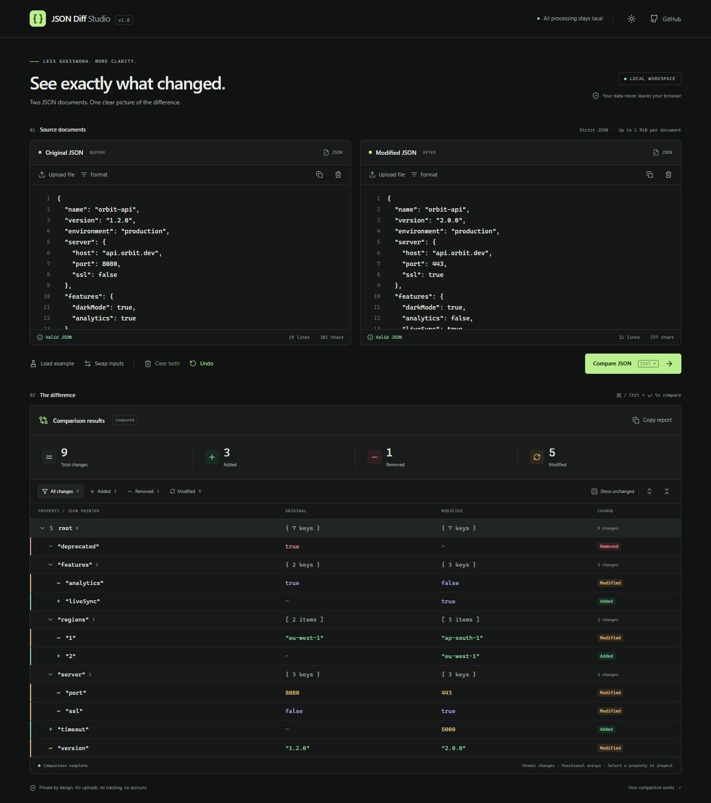

# JSON Diff Studio

A focused, browser-local workspace for comparing JSON. Paste or open two documents, compare them, and inspect exactly what was added, removed, or modified.

[Repository](https://github.com/pulkitdotio/json-diff-studio)



Actual browser captures: [desktop light](docs/screenshots/desktop-light.png), [mobile dark](docs/screenshots/mobile-dark.png), [mobile light](docs/screenshots/mobile-light.png).

## Features

- Two editors with line numbers, independent validation, local `.json` file loading, formatting, copy, and clear controls.
- A unified, collapsible difference tree with original and modified values, text labels, filters, and an optional unchanged view.
- Consistent statistics and full-value inspection, including escaped JSON Pointer paths.
- A structured JSON diff report you can copy to the clipboard.
- Working example data, swap, one-step Undo for input replacements, and Ctrl/⌘ + Enter to compare.
- Explicit stale-result notices after edits. Existing reports remain visible until you compare again.
- Dark and light themes, keyboard navigation, visible focus states, and responsive editor layouts.
- Bounded input size, nesting, value count, and incremental result rendering.

## Stack

React 19, TypeScript, Vite 7, Tailwind CSS 4, and Lucide React. Vitest and React Testing Library cover the engine and UI; Playwright covers desktop and mobile browser workflows.

## Install and run

Use Node.js **22.12 or later**; Node.js 24 is used in CI.

```sh
git clone https://github.com/pulkitdotio/json-diff-studio.git
cd json-diff-studio
npm ci
npm run dev
```

Open the local URL printed by Vite (normally `http://127.0.0.1:5173`). On Windows with PowerShell script execution disabled, use `npm.cmd` in place of `npm`.

```sh
npm run build       # Type-check and build static assets into dist/
npm run preview     # Serve the production build locally
```

No environment variables, API keys, accounts, or server configuration are required. This repository does not configure a hosted deployment.

## Usage

1. Paste JSON into **Original JSON** and **Modified JSON**, or use each editor's **Upload file** control. **Load example** fills both editors and runs a sample comparison.
2. Resolve any validation errors. **Format** uses two spaces and preserves the source's numeric literals, string escapes, and duplicate keys. Invalid input is never rewritten.
3. Choose **Compare JSON** or press Ctrl/⌘ + Enter.
4. Filter by change type, expand nested groups, or enable **Show unchanged**. Select a property to see its full values and JSON Pointer in the inspector. Escape closes the inspector; Tab moves between controls and out of editors.
5. Use **Copy report** for a structured report containing counts, paths, status, and old/new values. Clipboard access requires localhost or HTTPS and browser permission; failures produce a useful message.

Swap, uploads, example loading, and clearing support one-step **Undo**. Editing after a comparison marks the displayed report out of date; copying that report copies the previous comparison. Recompare to refresh it.

## Comparison behavior

- Objects compare by their own keys; key insertion order does not matter. Object paths are traversed in deterministic lexicographic order.
- Arrays compare **positionally**, in numeric index order. Reordering or inserting an array element can produce multiple modifications. Moves are not detected.
- Values compare by type and value without string coercion. `null` differs from a missing property, and an object differs from an array. All JSON root types are supported.
- Counts describe **atomic changes**: an added or removed property/array element counts once, including an entire nested object. A type replacement counts once. Within an existing object or array, individual changed descendants count separately; ancestor groups do not increase the total. Empty containers and root replacements follow the same rules.
- Paths follow [RFC 6901 JSON Pointer](https://www.rfc-editor.org/rfc/rfc6901): the empty string identifies the root; `/items/0` identifies an array element; `~` becomes `~0` and `/` becomes `~1` in property names. Dots have no special meaning. A property named `a/b` has path `/a~1b`, and an empty property name has path `/`.
- Reports use the format `json-diff-studio/v1`. An absent `before` or `after` field means missing; a field explicitly set to `null` means JSON null. The report is a comparison summary, **not** an RFC 6902 JSON Patch.
- The engine does not mutate parsed inputs. Filtering and collapsing only affect presentation.

## Privacy

JSON parsing, file reading, formatting, and comparison happen in your browser. The application has no backend, external processing API, analytics, tracking, remote fonts, or runtime CDN dependencies. Loading a file never transmits its contents.

Documents, the previous comparison, and one Undo snapshot stay in memory. They are not stored in localStorage, sessionStorage, or a database. Only your theme preference is saved in localStorage. Copy actions write the selected data to your system clipboard. GitHub links open GitHub when selected.

Reloading or closing the page clears the workspace. The app requests the browser's standard navigation warning while editors contain data; browser support and user interaction requirements determine whether it appears.

## Tests and checks

```sh
npm run lint
npm run typecheck
npm test
npm run test:watch
npm run build
```

Tests use synthetic data and cover nested values, missing versus null, positional arrays, root/type changes, special keys, deterministic ordering, input limits, malformed input, formatting, filters, statistics, upload failures, copying, Undo, keyboard access, and stale comparisons.

Run browser tests with Playwright's Chromium:

```sh
npx playwright install chromium
npm run test:e2e
```

Alternatively, use an installed Chrome by setting `PLAYWRIGHT_CHANNEL=chrome` (PowerShell: `$env:PLAYWRIGHT_CHANNEL = 'chrome'`). Playwright starts and stops a local Vite server automatically. Its desktop and mobile projects check comparison, filtering, inspection, layout overflow, keyboard interaction, real uploads, clipboard access, runtime errors, and absence of external processing requests.

GitHub Actions runs dependency installation, linting, type checking, unit/UI tests, and the production build on main-branch pushes and pull requests.

## Project structure

```text
src/
  components/       Editors, toolbar, summary, and difference viewer
  data/             Synthetic example documents
  lib/              Validation, source-preserving formatting, comparison, tests
  types/            JSON values and typed comparison results
  test/             React Testing Library setup
  App.tsx           Workspace state and browser interactions
  App.test.tsx      UI workflow tests
  index.css         Theme tokens and responsive styles
  main.tsx          Application entry
e2e/                Real-browser workflow tests
.github/workflows/  CI checks
```

## Known limits

- Strict JSON only: comments, trailing commas, and JSON5 are unsupported. Duplicate object keys follow `JSON.parse` semantics: the last occurrence determines the compared value. The formatter preserves all occurrences.
- Each document is limited to **1 MiB of UTF-8**, **20,000 parsed values** (containers included), and **100 nested levels** below the root. Oversized files or edits are rejected with a message and the previous document is kept. Documents exceeding the value-count or nesting limit remain visible but cannot be compared. Validation is iterative; comparison/render traversal is bounded by the validated depth.
- Numbers use JavaScript's number representation. Non-finite values, unsafe integers, decimal literals that would change on numeric round-trip, and underflow are rejected rather than silently rounded. Use JSON strings for exact high-precision decimals or large IDs. Equivalent spellings such as `1`, `1.0`, and `1e0` compare equally; `-0` and `0` compare equally.
- The diff tree initially renders up to 400 visible nodes. **Show 400 more** reveals additional rows; copying a report includes all changes regardless of the visible rows or filter.
- Editors use native textareas with line numbers; editor syntax highlighting and move-aware array comparisons are not implemented. Long values are shortened in rows; the inspector shows the complete parsed value.
- Processing is synchronous and intended for moderately sized documents. The input limits bound work; this is not a streaming or multi-megabyte file comparison tool.
